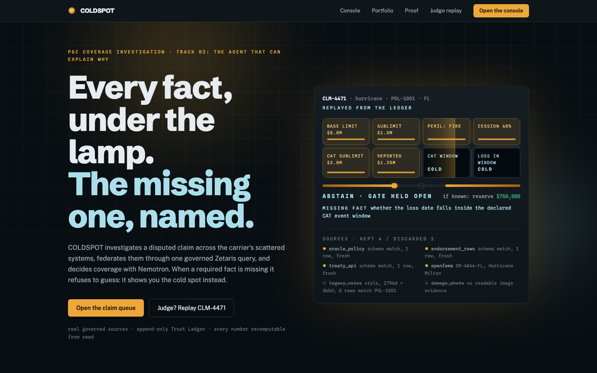

# COLDSPOT

**A carrier-side insurance reserving agent that finds the one coverage fact scattered systems cannot answer, and refuses to guess.** It discovers and federates fragmented carrier data through one governed query, reasons coverage with NVIDIA Nemotron, and either issues a reserve or abstains, naming the exact missing fact. When vision reads the document that closes the gap, the abstain becomes an auditable reserve with full lineage.



[]()
[]()
[]()
[]()
[]()

> Open Agent Hackathon 2026 (GenAI Works). Track 01 Solving Fragmented Intelligence (primary), Track 03 Reasoning Architecture, and the NVIDIA Nemotron special prize.

## Live now

- **App:** https://coldspot-agent.duckdns.org
- **Judge replay (the money beat, instant):** https://coldspot-agent.duckdns.org/demo
- **Proof surface (artifacts read at render):** https://coldspot-agent.duckdns.org/proof
- **Verify the headline numbers yourself (keyless):** `npm test` reproduces the core logic; `npm run evals` re-derives every cycle gate against live sources.

## What is COLDSPOT

A property and casualty claim is disputed across systems that do not talk to each other: the policy lives in one database, the endorsement in a filestore, the reinsurance treaty behind a REST API, the catastrophe declaration at a government agency, and the damage itself only in a photo. A human adjuster spends hours stitching these together before they can set a reserve.

COLDSPOT is the agent that does that stitching, and knows when it cannot. Given a claim, it discovers which scattered systems are relevant, federates them through **one governed Zetaris query** (one query, no in-app join), reconciles the coverage facts, and asks a simple question: is every fact present with confidence? If yes, it reserves, with the cession math shown. If one fact is missing, it **abstains**, naming the exact fact and the source that resolves it, rather than inventing a number. That missing fact is the cold spot. When a damage photo or a FEMA declaration is uploaded, **Nemotron vision reads it**, supplies the missing fact, and the deterministic gate flips the abstain into a reserve, every step lineage tracked.

> The engine is the source of truth, not the model. A deterministic completeness gate decides the verdict; the model gathers and explains but can never override it.

## How it works

1. **Discover and discard.** The agent probes a catalog of heterogeneous source types (Oracle SQL, filestore endorsements, a treaty REST API, live OpenFEMA, and images via vision) and discards a stale decoy on a signal-derived reason (last refreshed 2019, zero rows matching the policy), witnessed on screen.
2. **Federate through one governed query.** The confirmed sources are joined by a single Zetaris `run-stream` query. The in-app client exposes only `runFederatedQuery`, so an in-process join is structurally impossible: the federation is real.
3. **Reconcile and gate.** The federated rows become coverage facts. A deterministic `isComplete` gate checks every required fact. A missing fact means abstain, not a guess.
4. **Abstain, naming the cold spot.** For the hero claim, the catastrophe event window is unresolved, so the agent abstains and names it: "whether the loss date falls inside the declared CAT event window," plus the source that resolves it.
5. **Vision closes the gap.** Nemotron VL reads the uploaded FEMA declaration, extracts the real date window, and supplies the missing fact. The gate flips abstain into **reserve $750,000**, with the reinsurance cession math.
6. **Explain with lineage.** Every sentence of the decision links to the source fact and the ledger step that produced it. Click a sentence in the evidence graph and its provenance chain lights up.
7. **See the book.** The portfolio view aggregates the World Model across the estate: 8 claims, $1.68M reserved, and systemic cold-spot clusters (claims stuck on the same missing fact). "Re-derive from live sources" recomputes a decision identically, proving it was earned, not stored.

## Sponsor technology, made load-bearing

| Sponsor | How it is used (not a checkbox) | Proof |
|---------|--------------------------------|-------|
| **Zetaris** | One governed federated query joins policy + endorsement (filestore) + treaty (REST). The in-app client exposes only `runFederatedQuery`, so an in-app join is structurally impossible. The policy source is a Zetaris filestore populated from Oracle (an extraction for this build, not a live link to that one system). | `src/adapters/zetaris/`, `npm run evals` (C3 discovery), live `/app` |
| **NVIDIA Nemotron** | Two-turn reasoning (plan then decide) plus the hero: Nemotron VL reads the uploaded FEMA declaration and supplies the fact that flips abstain into reserve. | `src/adapters/nemotron/`, `/demo` replay |
| **Meterless** | The real vendored engines run the product: H-MEM is the earned Trust Ledger, the World Model projects the portfolio, Scout routes intent and blocks jailbreaks. Our impl passes the Meterless conformance suite. | `npm run conformance` (H-MEM 13/13, Scout PASS), `vendor/meterless/` |

## Architecture

```
Browser (Next.js 15 App Router, dark operator console)
  |
  |  /api/claim/resolve, /resolve/stream (NDJSON), /[id]/recompute, /portfolio, /ledger, /treaty
  v
COLDSPOT agent server (one monolithic Next.js full-stack app)
  |-- orchestrator: discover -> probe -> federate -> reconcile -> VERIFY -> decide (engine-as-truth gate)
  |-- Zetaris client: ONE governed run-stream federated JOIN (no in-app join)
  |-- Nemotron adapter: 2-turn reasoning + vision (VL reads the FEMA / damage image)
  |-- Meterless engines (vendored): H-MEM Trust Ledger, World Model, Scout Intent
  |-- OpenFEMA client: live declared CAT window (seeded-real fallback, truthfully logged)
  v
Oracle Autonomous Database (policy / claim / treaty, mTLS wallet)  +  OpenFEMA (live)
```

Stack: `Next.js 15.5` / `React 19` / `TypeScript` / `oracledb` (thin, mTLS) / `Zod` / `Tailwind v4`. Deployed on Oracle Cloud (always-on compute) behind Caddy with automatic TLS.

## Core invariants

These are enforced in code, not promised in prose:

- **No mock federation.** The federated JOIN runs in Zetaris; the client cannot join in-process.
- **Engine is the source of truth.** A deterministic gate decides reserve or abstain. The model never overrides it. Identical inputs give identical verdicts (proven 3x in evals).
- **Fail closed.** Under a source outage or partial data, the agent abstains or returns an honest error. It never fabricates a verdict.
- **The Trust Ledger is earned.** Every ledger entry is produced by a real resolve through the live path, never authored by hand.

## Honesty ledger

See `CLAIMS.md` for the full capability ledger (what is real, what is representative, what is deferred). In short: the carrier policy data is representative-seeded (real carrier APIs are not public), while the federation, reasoning, live OpenFEMA data, vision reads, and Meterless engines are all real. `LIMITATIONS.md` and `SECURITY.md` carry the scope boundary and threat model.

## Verify in 60 seconds

```bash
npm ci
npm test            # 53 tests: orchestrator, reconcile gate, evidence graph, world model
npm run evals       # re-derives every cycle gate (scout, causality, c2, c3, recompute) against live sources
npm run conformance # Meterless conformance: H-MEM 13/13, Scout PASS
```

`npm test` runs keyless and offline. `npm run evals` and `npm run conformance` exercise the live stack and need the environment configured (see below).

## Running locally

```bash
git clone https://github.com/dmustapha/coldspot.git
cd coldspot
npm ci
cp .env.example .env.local   # fill in NVIDIA NIM key, Oracle ADB wallet + creds, Zetaris endpoint
npm run dev                  # http://localhost:3100
```

Full live federation needs the Zetaris stack running (see `docs/DESIGN-HANDOFF.md` and `Dockerfile`). The read surfaces, the portfolio, the evidence graph, and the `/demo` replay work from the committed earned ledger without it.

## Tests

- **Unit (offline, keyless):** `npm test`. 53 tests over the orchestrator, the reconcile gate, the evidence-graph provenance, and the World Model.
- **Integration:** `npm run test:int`.
- **Evals (live):** `npm run evals`. Each is a falsifiable gate: Scout routing 9/9, abstain to reserve causality, VERIFY agreement, 5+ source-type discovery with decoy discard, and recompute determinism.
- **Conformance (sponsor claim):** `npm run conformance`. Proves the vendored Meterless engines pass their own suite.

## Hackathon alignment

| Criterion | Where COLDSPOT earns it |
|-----------|-------------------------|
| **Impact (30)** | A real, high-cost enterprise problem (reserving on fragmented carrier data) for a real user (the adjuster). Track 01 head-on. |
| **Technical (20)** | One governed federated JOIN, a deterministic engine-as-truth gate, fail-closed reliability under source outage, proven determinism. |
| **Innovation (15)** | Vision closes the coverage gap (abstain to reserve); the interactive evidence graph makes lineage the product; auditable recompute-from-live. |
| **Demo (15)** | The streamed money beat: watch discover, discard, federate, vision, reconcile, decide, with full lineage, on the instant replay surface. |
| **Product and UX (10)** | A dense, legible operator console with a coherent dark identity; the book view shows systemic cold spots across the estate. |
| **Sponsor tech (10)** | Zetaris, Nemotron (text and vision), and Meterless are each load-bearing, with runnable proof. |

## Documentation

- `DECISIONS.md` architecture decision log
- `SECURITY.md` threat model and what is not defended against
- `LIMITATIONS.md` scope boundary
- `CLAIMS.md` capability and honesty ledger
- `DESIGN_SYSTEM.md` and `docs/DESIGN-HANDOFF.md` the visual identity and wiring contract
- `JUDGES.md` the one-command judge entry point

## License

MIT. See `LICENSE`.
